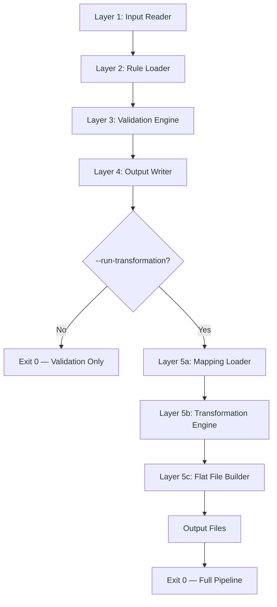
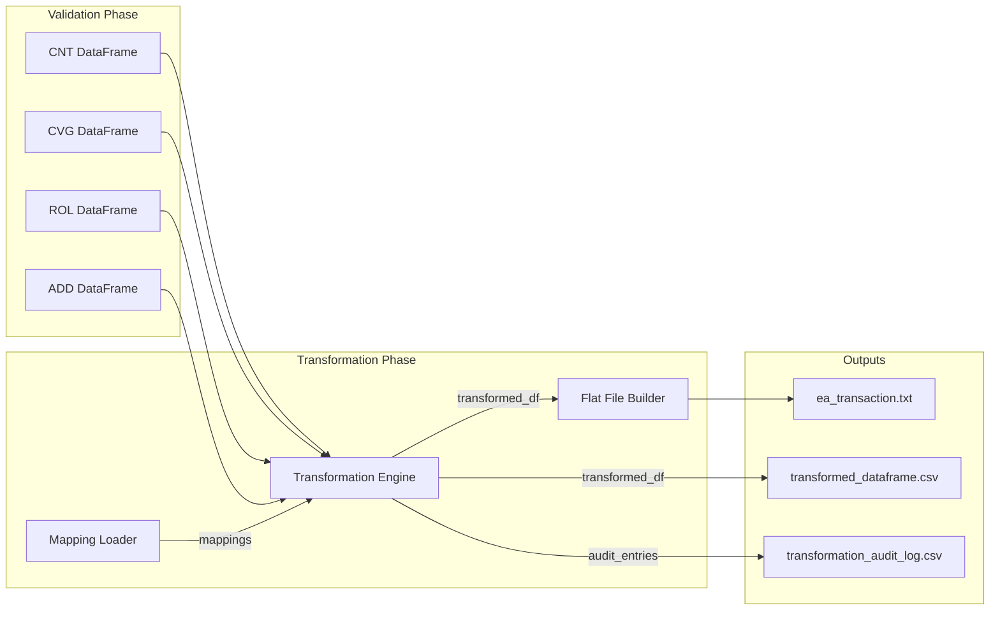
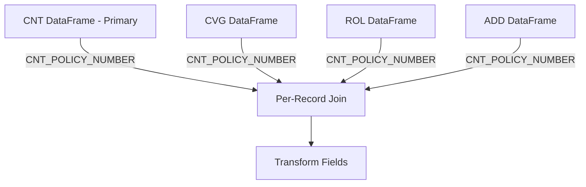
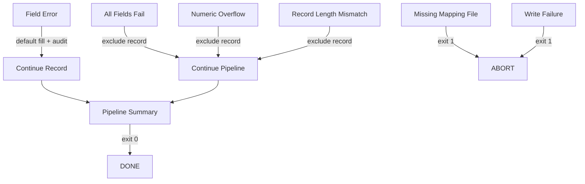

> **SUPPLEMENTARY SPEC** — subordinate to option-b-config-driven-engine, which is the authoritative top-level specification. This spec describes transformation-layer internals in more granular detail. Requirements 24-26 here are equivalent to Requirements 23-24/22 in option-b-config-driven-engine — do not implement both independently.

# Design Document: EA Transformation Engine

## Overview

The EA Transformation Engine extends the existing Policy Loader ETL Validation Pipeline with a metadata-driven transformation layer (Layer 5). It consumes validated in-memory DataFrames (CLEAN and WARNING rows from CNT, CVG, ROL, ADD tables), applies transformation rules loaded from `rules/POC_Transformation_Mapping.csv`, and produces three outputs:

1. **ea_transaction.txt** — Fixed-width positional flat file for the End-state Administration system
2. **transformed_dataframe.csv** — Intermediate columnar CSV for inspection and validation
3. **transformation_audit_log.csv** — Per-field-per-record audit trail

The transformation layer is triggered by the `--run-transformation` CLI flag and runs AFTER the existing validation phase completes. It does not modify, replace, or re-read any existing validation components or outputs.

### Design Rationale

The metadata-driven approach ensures that new fields and transformation rules can be added by editing the mapping CSV — no code changes required to the engine. The dispatcher pattern (registry dictionary) enables new transformation types to be plugged in by registering a handler function.

## Architecture

### Extended Pipeline Flow



### Data Flow



### Key Architecture Decisions

| Decision | Choice | Rationale |
|----------|--------|-----------|
| Metadata-driven dispatch | Registry dict of handler functions | No hardcoded field mappings; new types added without touching engine |
| In-memory DataFrame passing | DataFrames passed directly from validation | No I/O overhead; no dependency on intermediate CSV files |
| Single mapping file | POC_Transformation_Mapping.csv | Central management; sequence order from Original Sheet Row |
| New modules only | No modifications to existing validation modules | Existing 141 tests remain unchanged; zero regression risk |
| Layer 5 placement | After Layer 4 (Output Writer) | Transformation consumes validated data; validation outputs are unaffected |

## Components and Interfaces

### Module Structure (new files only)

```
src/
├── mapping_loader.py           # Layer 5a: Load/validate/filter POC_Transformation_Mapping.csv
├── transformation_engine.py    # Layer 5b: Metadata-driven transformation orchestration
├── flat_file_builder.py        # Layer 5c: Fixed-width positional record assembly
└── transformation_utils.py     # Layer 5: Shared helpers (date_split, format_field, pad_value)
tests/
├── test_mapping_loader.py
├── test_transformation_engine.py
├── test_flat_file_builder.py
└── test_transformation_utils.py
```

### mapping_loader.py

```python
"""Layer 5a — Mapping Loader.

Reads, validates, filters, and returns transformation mappings from
rules/POC_Transformation_Mapping.csv. This is the ONLY module that
opens or parses the mapping file.
"""
from pathlib import Path
import pandas as pd

MAPPING_FILE_PATH = Path("rules") / "POC_Transformation_Mapping.csv"

REQUIRED_COLUMNS = [
    "POC Scope", "Target Section", "Target Field", "Target Level",
    "Target PIC Format", "Target Length", "Target Data Type",
    "Source Table(s)", "Source Field(s)", "Transformation Type",
    "Transformation Rule", "Default / Constant Value", "Date Handling",
    "Padding Rule", "Truncation Rule", "Dependency Table",
    "Validation Required Before Transform", "Mapping Status",
    "Open Question / Comment", "Original Sheet Row", "Screen",
    "Definition", "Allowable Values",
]

EXCLUDED_STATUSES = frozenset([
    "Open - Clarification Needed",
    "Review Required",
    "Out of Scope",
    "Not Used",
])

def load(mapping_path: Path | None = None) -> list[dict]:
    """Load, validate, filter and return transformation mappings in sequence order."""

def _validate_columns(df: pd.DataFrame) -> None:
    """Raise ValueError if required columns are missing."""

def _filter_poc_scope(df: pd.DataFrame) -> pd.DataFrame:
    """Keep only rows where POC Scope = 'Yes' or 'Yes - Default/System'."""

def _filter_mapping_status(df: pd.DataFrame) -> pd.DataFrame:
    """Exclude rows with status in EXCLUDED_STATUSES."""

def _filter_transformation_type(df: pd.DataFrame) -> pd.DataFrame:
    """Exclude GROUP_OR_PARENT rows."""

def _filter_source_tables(df: pd.DataFrame) -> pd.DataFrame:
    """Exclude mappings requiring unavailable future-phase source tables (PRM, FIN, NFN)."""

def _to_mapping_dicts(df: pd.DataFrame) -> list[dict]:
    """Convert filtered DataFrame to list of mapping dicts, sorted by Original Sheet Row."""
```

### transformation_engine.py

```python
"""Layer 5b — Transformation Engine.

Orchestrates metadata-driven transformations via a dispatcher registry.
Contains NO hardcoded field names, source column references, or target
column references. All behavior is driven by the mapping metadata.
"""
from typing import Callable
import pandas as pd

# Handler registry — maps Transformation Type to handler function
HANDLER_REGISTRY: dict[str, Callable] = {
    "DIRECT_SOURCE": _handle_direct_source,
    "DATE_SPLIT": _handle_date_split,
    "CONSTANT": _handle_constant,
    "INITIALIZE_SPACES": _handle_initialize_spaces,
    "INITIALIZE_NUMERIC_OR_DATE": _handle_initialize_numeric,
    "SYSTEM_GENERATED": _handle_system_generated,
    "CONDITIONAL_OR_DERIVED": _handle_conditional,
}

def transform(
    mappings: list[dict],
    cnt_df: pd.DataFrame,
    cvg_df: pd.DataFrame | None = None,
    rol_df: pd.DataFrame | None = None,
    add_df: pd.DataFrame | None = None,
) -> tuple[pd.DataFrame, list[dict]]:
    """Apply all transformations to eligible records.
    
    Returns: (transformed_df, audit_entries)
    """

def _get_eligible_records(df: pd.DataFrame) -> pd.DataFrame:
    """Filter to CLEAN and WARNING rows only."""

def _resolve_source_value(
    mapping: dict, record: pd.Series, source_dfs: dict[str, pd.DataFrame]
) -> str:
    """Look up the source field value from the appropriate source table."""

def _apply_single_mapping(
    mapping: dict, record: pd.Series, source_dfs: dict
) -> tuple[str, dict]:
    """Dispatch one mapping to its handler. Returns (value, audit_entry)."""

def _handle_direct_source(mapping: dict, source_value: str) -> str:
    """Copy source value, apply formatting/padding."""

def _handle_date_split(mapping: dict, source_value: str) -> str:
    """Split YYYYMMDD date into component (year/month/day)."""

def _handle_constant(mapping: dict) -> str:
    """Return the constant value from Default/Constant Value column."""

def _handle_initialize_spaces(mapping: dict) -> str:
    """Fill with spaces to Target Length."""

def _handle_initialize_numeric(mapping: dict) -> str:
    """Fill with zeroes (or configured default) to Target Length."""

def _handle_system_generated(mapping: dict) -> str:
    """Initialize by data type, log as placeholder."""

def _handle_conditional(mapping: dict, source_value: str, record: pd.Series) -> str:
    """Execute named conditional rule or skip if ambiguous."""
```

### flat_file_builder.py

```python
"""Layer 5c — Flat File Builder.

Concatenates transformed field values in mapping sequence order to produce
a fixed-width positional flat file. No delimiters between fields.
"""
from pathlib import Path
import pandas as pd

def build(transformed_df: pd.DataFrame, mappings: list[dict]) -> list[str]:
    """Build fixed-width positional records from transformed DataFrame.
    
    Returns list of record strings, one per eligible record.
    Excludes records where total length != expected sum.
    """

def write(records: list[str], output_path: Path) -> None:
    """Write records to ea_transaction.txt, one per line, newline-terminated."""

def _calculate_expected_length(mappings: list[dict]) -> int:
    """Sum all Target Lengths from the active mapping set."""

def _verify_record_length(record: str, expected_length: int, record_id: str) -> bool:
    """Verify record is exactly expected_length characters. Log error if not."""
```

### transformation_utils.py

```python
"""Layer 5 — Shared Transformation Helpers.

Pure utility functions used by the transformation engine and flat file builder.
No side effects, no file I/O, no state.
"""

def format_field(value: str, target_length: int, data_type: str, padding_rule: str = "") -> str:
    """Format a value to exactly target_length using the specified padding rule.
    
    - CHAR: right-pad with spaces
    - NUMERIC / PACKED_DECIMAL: left-pad with zeroes
    Returns truncated (CHAR only) or raises error (NUMERIC) if value exceeds target_length.
    """

def split_date(date_value: str, target_length: int, target_field: str, date_handling: str = "") -> str:
    """Extract year/month/day component from YYYYMMDD date string.
    
    Primary: parse Date Handling column instruction.
    Fallback: determine component from target_length and target_field naming convention:
      - 4 chars = year (positions 0:4)
      - 2 chars + 'MM'/'MO' in name = month (positions 4:6)
      - 2 chars + 'DD'/'DA' in name = day (positions 6:8)
    Returns zeroes if date_value is blank or < 8 characters.
    """

def pad_char(value: str, length: int) -> str:
    """Right-pad with spaces to length. Truncate if longer."""

def pad_numeric(value: str, length: int) -> str:
    """Left-pad with zeroes to length. Raise ValueError if longer."""

def initialize_field(data_type: str, length: int) -> str:
    """Return default initialization: spaces for CHAR, zeroes for NUMERIC/PACKED_DECIMAL."""
```

### Integration with main.py

Minimal extension to the existing entry point:

```python
# After existing validation completes, inside main():

parser.add_argument(
    "--run-transformation",
    action="store_true",
    default=False,
    help="Run transformation phase after validation (produces ea_transaction.txt)",
)

# ... after all table validation and output writing ...

if args.run_transformation:
    print("\n" + "=" * 50)
    print("[TRANSFORM] Starting transformation phase")
    print("=" * 50)

    from src.mapping_loader import load as load_mappings
    from src.transformation_engine import transform
    from src.flat_file_builder import build, write as write_flat_file

    mappings = load_mappings()
    transformed_df, audit_entries = transform(
        mappings, validated_cnt, cvg_df, rol_df, add_df
    )
    records = build(transformed_df, mappings)
    write_flat_file(records, output_dir / "ea_transaction.txt")

    # Write intermediate columnar output
    transformed_df.to_csv(output_dir / "transformed_dataframe.csv", index=False)

    # Write audit log
    audit_df = pd.DataFrame(audit_entries)
    audit_df.to_csv(output_dir / "transformation_audit_log.csv", index=False)

    print(f"[TRANSFORM] Transformation complete: {len(records)} records written")
```

**Note:** The `cvg_df`, `rol_df`, `add_df` variables must be persisted from the validation phase (currently they are local to their processing blocks in main.py). The minimal refactor moves them to function-level scope.

## Data Models

### Mapping Entry (from mapping_loader)

Each row from the Transformation Mapping CSV is parsed into a structured dictionary:

```python
MappingEntry = {
    "target_field": str,            # e.g. "COMPANY-CODE"
    "target_section": str,          # e.g. "EA1", "EA Transaction"
    "target_length": int,           # e.g. 3, 15, 4
    "target_data_type": str,        # CHAR | NUMERIC | PACKED_DECIMAL
    "target_pic_format": str,       # e.g. "PIC XXX.", "PIC 9(4)."
    "source_tables": list[str],     # Parsed from semicolon-separated "Source Table(s)"
    "source_fields": list[str],     # Parsed from semicolon-separated "Source Field(s)"
    "transformation_type": str,     # DIRECT_SOURCE | DATE_SPLIT | CONSTANT | etc.
    "transformation_rule": str,     # Free-text rule description
    "default_value": str,           # From "Default / Constant Value"
    "date_handling": str,           # e.g. "Split YYYYMMDD into YY/MM/DD components"
    "padding_rule": str,            # e.g. "Right pad with spaces; truncate only if approved"
    "truncation_rule": str,         # e.g. "Do not truncate unless..."
    "dependency_table": str,        # e.g. "CVG", "ROL", "ADD;ROL"
    "mapping_status": str,          # e.g. "Confirmed for POC Review"
    "poc_scope": str,               # "Yes" or "Yes - Default/System"
    "original_sheet_row": int,      # Used for deterministic sequence ordering
    "target_level": str,            # Target Level column value
}
```

### Audit Log Entry

Each field transformation produces one audit entry:

```python
AuditEntry = {
    "record_id": str,               # CNT_POLICY_NUMBER of the source record
    "source_table": str,            # e.g. "CNT", "CVG"
    "source_field": str,            # e.g. "CNT_POLICY_NUMBER"
    "target_field": str,            # e.g. "MASTER-ID"
    "transformation_type": str,     # e.g. "DIRECT_SOURCE"
    "mapping_status": str,          # e.g. "Confirmed for POC Review"
    "processing_status": str,       # SUCCESS | SKIPPED | ERROR
    "output_value_length": int,     # Actual length of the produced value
    "error_or_skip_reason": str,    # Empty for SUCCESS; descriptive for SKIPPED/ERROR
}
```

### Transformation Type Handler Behavior

| Type | Input | Behavior | Output |
|------|-------|----------|--------|
| DIRECT_SOURCE | Source field value | Read → format_field() | Padded value at Target Length |
| DATE_SPLIT | Source date (YYYYMMDD) | split_date() using Date Handling or naming convention | Year (4) or Month (2) or Day (2) |
| CONSTANT | Default/Constant Value column | Read constant → format_field() | Padded constant at Target Length |
| INITIALIZE_SPACES | None (ignores source) | Return spaces × Target Length | Space-filled string |
| INITIALIZE_NUMERIC_OR_DATE | Default value or zeroes | Return zeroes (or default) × Target Length | Zero-filled string |
| SYSTEM_GENERATED | Target Data Type | Initialize by type; log as placeholder | Spaces (CHAR) or zeroes (NUMERIC) |
| CONDITIONAL_OR_DERIVED | Source value + rule text | Execute named rule fn if clear; skip if ambiguous | Derived value or default |

### Multi-Table Join Strategy



- **Primary key:** `CNT_POLICY_NUMBER` links CNT to all child tables
- **Secondary keys:** Derived from mapping metadata (Dependency Table, Source Field(s) columns) — e.g., `PERSON_SEQUENCE` for ROL/ADD disambiguation
- **Join approach:** Per-record during transformation. For each CNT record, look up matching child table rows by policy number
- **Missing child rows:** Initialize affected target fields with defaults for their Target Data Type, log in audit with processing_status = "SKIPPED"

### Output File Formats

| File | Format | Description |
|------|--------|-------------|
| `ea_transaction.txt` | Fixed-width positional | No delimiters, one record per line, newline-terminated. Record length = sum(Target Lengths) |
| `transformed_dataframe.csv` | Standard CSV | Headers = target field names in mapping sequence order. One row per eligible record |
| `transformation_audit_log.csv` | Standard CSV | 9 columns: record_id, source_table, source_field, target_field, transformation_type, mapping_status, processing_status, output_value_length, error_or_skip_reason |

## Correctness Properties

*A property is a characteristic or behavior that should hold true across all valid executions of a system — essentially, a formal statement about what the system should do. Properties serve as the bridge between human-readable specifications and machine-verifiable correctness guarantees.*

### Property 1: Mapping Filter Correctness

*For any* set of mapping rows loaded from the Transformation Mapping CSV, the filtered result SHALL contain only rows where POC Scope is in {"Yes", "Yes - Default/System"} AND Transformation Type is not "GROUP_OR_PARENT" AND Mapping Status is not in {"Open - Clarification Needed", "Review Required", "Out of Scope", "Not Used"}.

**Validates: Requirements 1.3, 1.4, 1.5**

### Property 2: Mapping Sequence Ordering

*For any* set of filtered mapping rows, the output list SHALL be sorted in ascending order by the Original Sheet Row value. For all consecutive pairs (mappings[i], mappings[i+1]), mappings[i].original_sheet_row < mappings[i+1].original_sheet_row.

**Validates: Requirements 1.6, 2.1**

### Property 3: Column Validation Rejects Incomplete Schemas

*For any* DataFrame loaded from a CSV file that is missing one or more of the 23 required columns, the Mapping Loader SHALL raise a ValueError. The set of required columns is fixed and complete; any proper subset triggers rejection.

**Validates: Requirements 1.2**

### Property 4: Only Eligible Records Are Transformed

*For any* input DataFrame containing records with ROW_SEVERITY values from {CLEAN, WARNING, SEVERE}, the Transformation Engine SHALL produce output containing only records whose original ROW_SEVERITY was CLEAN or WARNING. No record with ROW_SEVERITY = SEVERE SHALL appear in the transformed output or the flat file.

**Validates: Requirements 2.4, 14.3, 14.4**

### Property 5: Every Transformed Field Is Exactly Target Length

*For any* mapping entry and any source value (including blank, short, or oversized values), the transformed field value SHALL be exactly `target_length` characters. CHAR fields are right-padded with spaces; NUMERIC and PACKED_DECIMAL fields are left-padded with zeroes. This invariant holds across all transformation types (DIRECT_SOURCE, DATE_SPLIT, CONSTANT, INITIALIZE_SPACES, INITIALIZE_NUMERIC_OR_DATE, SYSTEM_GENERATED, CONDITIONAL_OR_DERIVED).

**Validates: Requirements 3.2, 3.3, 3.4, 3.5, 10.1, 10.2, 10.3, 10.4**

### Property 6: DATE_SPLIT Component Extraction

*For any* valid YYYYMMDD date string and any DATE_SPLIT mapping, the extracted component SHALL match the correct substring: year = positions 0:4 (length 4), month = positions 4:6 (length 2), day = positions 6:8 (length 2). The component selection is determined by Target Length and target field naming convention (YY→year, MM/MO→month, DD/DA→day) when Date Handling is blank.

**Validates: Requirements 4.1, 4.2, 4.3**

### Property 7: Numeric Overflow Excludes Record

*For any* NUMERIC or PACKED_DECIMAL field where the source value (after stripping non-numeric characters) has more digits than Target Length, the Transformation Engine SHALL NOT truncate the value. Instead, the entire record SHALL be excluded from the flat file output, and an audit entry with processing_status = "ERROR" SHALL be recorded.

**Validates: Requirements 10.6**

### Property 8: Flat File Record Length Invariant

*For any* record in the flat file output, the total record length (number of characters per line, excluding the newline terminator) SHALL equal the sum of all Target Lengths from the active mapping set. There SHALL be no delimiter characters between fields — the record is pure concatenation in mapping sequence order.

**Validates: Requirements 11.1, 11.2, 11.3**

### Property 9: Audit Completeness

*For any* transformation run processing N eligible records with M active mappings, the audit log SHALL contain exactly N × M entries (one entry per field per record). No field processing result SHALL be silently discarded without an audit entry.

**Validates: Requirements 13.2, 13.5**

### Property 10: Audit Status Constraint

*For any* audit log entry, the processing_status value SHALL be one of {SUCCESS, SKIPPED, ERROR}. Furthermore, for any entry where processing_status is SKIPPED or ERROR, the error_or_skip_reason field SHALL be non-empty (contain a descriptive reason).

**Validates: Requirements 13.3, 13.4**

### Property 11: Output Reproducibility

*For any* set of input DataFrames and the same Transformation Mapping CSV, running the transformation twice SHALL produce byte-identical `ea_transaction.txt` and `transformed_dataframe.csv` files. The `transformation_audit_log.csv` SHALL be logically identical (same rows in same order). No non-deterministic elements (random values, process IDs, timestamps in data columns) SHALL be introduced into the output files.

**Validates: Requirements 21.1, 21.2, 21.3, 21.4**

### Property 12: Multi-Table Join by Policy Number

*For any* mapping that specifies a child source table (CVG, ROL, ADD), the Transformation Engine SHALL resolve the source value by joining on CNT_POLICY_NUMBER. When a matching child record exists, the correct source field value from that child table SHALL be returned. When no match exists, the target field SHALL be initialized with the default for its Target Data Type.

**Validates: Requirements 15.1, 15.3**

### Property 13: Error Recovery Continues Processing

*For any* record where a single field transformation fails, the Transformation Engine SHALL continue processing all remaining fields for that record. The failed field SHALL receive the default fill value for its Target Data Type, and an audit entry with processing_status = "ERROR" SHALL be recorded. The record SHALL still appear in the output (unless ALL fields fail or a numeric overflow triggers exclusion per Property 7).

**Validates: Requirements 2.5, 18.2**

### Property 14: Handler Dispatch Correctness

*For any* mapping entry with a Transformation Type that exists in the HANDLER_REGISTRY, the Transformation Engine SHALL invoke the handler function registered for that exact type string. The dispatch is a pure lookup — no conditional logic selects the handler based on field content or other metadata.

**Validates: Requirements 2.2, 2.7**

### Property 15: Columnar Output Structure

*For any* transformation run, the `transformed_dataframe.csv` SHALL have column headers equal to the target field names from the active mapping set, in the same sequence order as the mappings (sorted by Original Sheet Row). The number of data rows SHALL equal the number of eligible records that were not excluded by errors.

**Validates: Requirements 12.2, 12.3, 12.4**

## Error Handling

### Error Classification and Behavior

| Error Condition | Severity | Action | Exit Code |
|----------------|----------|--------|-----------|
| Mapping file missing or unreadable | FATAL | Log `[TRANSFORM]` error, abort transformation | 1 |
| Missing required column in mapping CSV | FATAL | Log `[TRANSFORM]` error listing missing columns, abort | 1 |
| Output directory unwritable | FATAL | Log `[TRANSFORM]` error, abort | 1 |
| Single field transformation fails | FIELD | Default fill, audit ERROR entry, continue record | 0 |
| All fields fail for one record | RECORD | Exclude record from flat file, audit ERROR, log exclusion | 0 |
| NUMERIC value exceeds Target Length | RECORD | Exclude entire record, audit ERROR, no truncation | 0 |
| Record length ≠ expected sum | RECORD | Exclude record, audit ERROR, include in summary count | 0 |
| Missing child table record for join | FIELD | Default initialization for affected fields, audit SKIPPED | 0 |
| Ambiguous CONDITIONAL_OR_DERIVED rule | FIELD | Skip field, default fill, audit SKIPPED with reason | 0 |
| Source table not available (e.g., PRM) | FIELD | Default initialization, audit SKIPPED | 0 |

### Error Propagation



### Logging Convention

All transformation-phase log output uses the `[TRANSFORM]` prefix, extending the existing prefix table:

| PREFIX | LEVEL | MEANING |
|--------|-------|---------|
| `TRANSFORM` | INFO | Transformation phase progress, record counts, file output |
| `TRANSFORM` | WARNING | Field truncation, missing child records, skipped fields |
| `TRANSFORM` | ERROR | Field failures, record exclusions, file I/O errors |

### Pipeline Completion Summary

```
[TRANSFORM] Transformation Summary
[TRANSFORM]   Total eligible records: X
[TRANSFORM]   Records transformed:    Y
[TRANSFORM]   Records excluded:       Z (numeric overflow: A, length mismatch: B, all-fields-failed: C)
[TRANSFORM]   Total fields processed: N
[TRANSFORM]   Fields succeeded:       P
[TRANSFORM]   Fields skipped:         Q
[TRANSFORM]   Fields errored:         R
[TRANSFORM]   Output files written:   ea_transaction.txt, transformed_dataframe.csv, transformation_audit_log.csv
```

## Testing Strategy

### Testing Framework

- **Framework:** pytest (already in use for existing 141 validation tests)
- **Property-based testing:** [Hypothesis](https://hypothesis.readthedocs.io/) for Python
- **Regression baseline:** 141 existing validation tests (must all pass unchanged)

### Dual Testing Approach

**Unit Tests** — Verify specific examples, edge cases, and error conditions:
- Each transformation handler with known inputs/outputs
- Mapping loader with known CSV content
- Flat file builder with known field values
- Error conditions (missing file, overflow, write failure)
- CONDITIONAL_OR_DERIVED specific rules (PRODUCT-CODE, NON-FORFEIT-OVERRIDE-IND, DIVIDEND-OPT-CODE)

**Property Tests** — Verify universal properties across randomized inputs:
- Each correctness property (Properties 1–15) implemented as a Hypothesis test
- Minimum 100 iterations per property test
- Tag format: `# Feature: ea-transformation-engine, Property N: <property_text>`

### Test File Organization

| Test File | Covers | Approach |
|-----------|--------|----------|
| `test_mapping_loader.py` | Properties 1, 2, 3 + examples for logging, edge cases | Unit + Property |
| `test_transformation_engine.py` | Properties 4, 5, 6, 7, 9, 10, 12, 13, 14 + handler examples | Unit + Property |
| `test_flat_file_builder.py` | Property 8 + length verification examples | Unit + Property |
| `test_transformation_utils.py` | Property 5 (format_field, pad_char, pad_numeric, split_date) | Unit + Property |
| `test_e2e_transformation.py` | Property 11, 15 + end-to-end flow | Integration |
| `test_regression.py` | All 141 existing tests pass | Regression |

### Property-Based Test Configuration

```python
from hypothesis import given, settings, strategies as st

@settings(max_examples=100)
@given(...)
def test_property_N_description(data):
    """Feature: ea-transformation-engine, Property N: <property_text>"""
    ...
```

### Hypothesis Strategies (Custom Generators)

Key custom strategies needed:
- `mapping_entries()` — generates valid MappingEntry dicts with random but valid field combinations
- `eligible_dataframes()` — generates DataFrames with ROW_SEVERITY in {CLEAN, WARNING, SEVERE}
- `date_strings()` — generates valid/invalid YYYYMMDD date strings
- `field_values(data_type, target_length)` — generates values appropriate to data type
- `mapping_csvs()` — generates DataFrames with all 23 required columns (some missing for Property 3)

### Test Execution

```bash
# Run all tests (validation + transformation)
pytest

# Run only transformation tests
pytest tests/test_mapping_loader.py tests/test_transformation_engine.py tests/test_flat_file_builder.py tests/test_transformation_utils.py tests/test_e2e_transformation.py

# Run with property test verbosity
pytest --hypothesis-show-statistics

# Verify regression baseline
pytest tests/test_field_validator.py tests/test_input_reader.py tests/test_output_writer.py tests/test_rule_loader.py tests/test_validate_add.py tests/test_validate_cvg.py tests/test_validate_rol.py tests/test_validation_engine.py tests/test_validation_utils.py
```

### POC Limitations Documented for Testing

1. **COMP-3 (PACKED_DECIMAL)** — Represented as zero-padded numeric strings, not actual packed encoding. Tests verify string representation only.
2. **CONDITIONAL_OR_DERIVED** — Only rules with clearly described logic are implemented. Ambiguous rules are skipped and logged. Tests verify skip behavior for ambiguous cases.
3. **Secondary join keys** — POC uses CNT_POLICY_NUMBER as primary join. Complex multi-key joins (e.g., PERSON_SEQUENCE disambiguation across multiple child records) are documented as Phase 2 enhancements.
