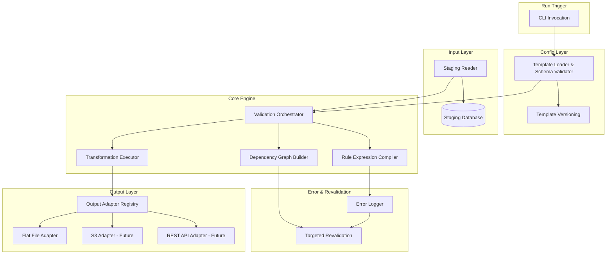
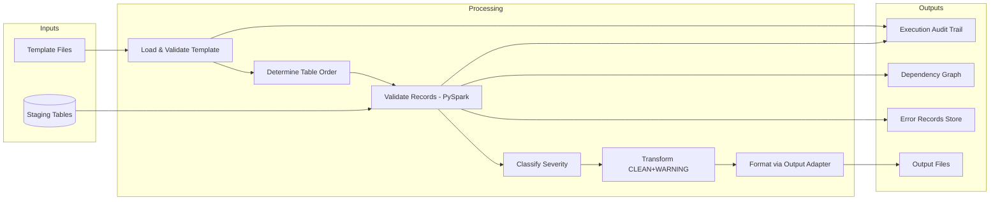
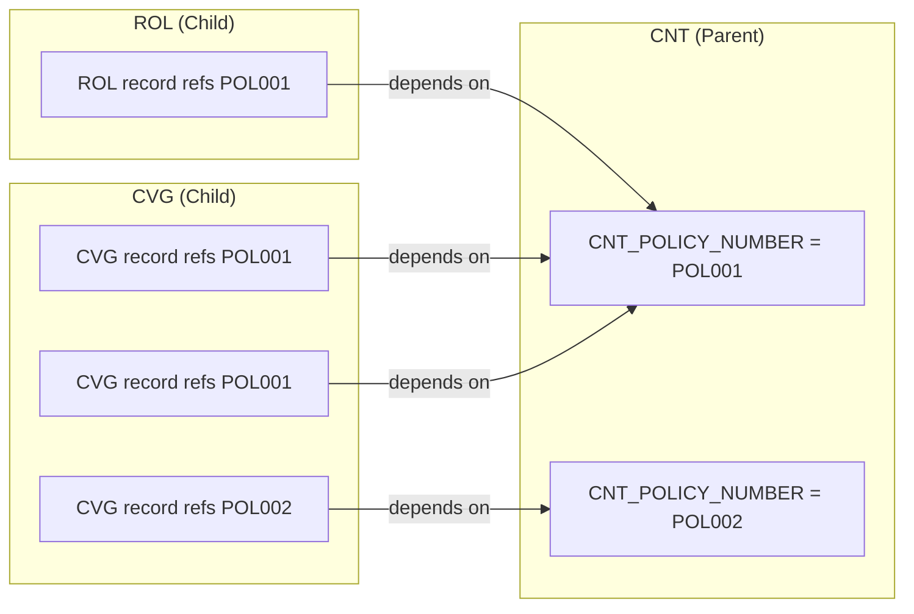
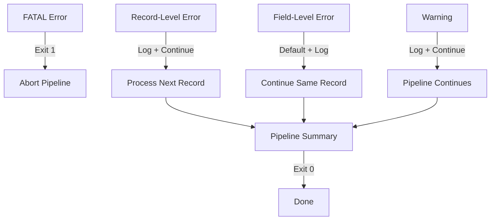

# Design Document: Option B — Config-Driven PySpark Validation & Transformation Engine

## Overview

Option B replaces the current Pandas-based, code-centric validation pipeline (Option A) with a single, fixed PySpark interpreter engine that reads all validation rules, transformation mappings, and output configuration from versioned Template files at runtime. No code is generated at any point — the engine translates declarative Template rules directly into PySpark DataFrame column expressions.

### Key Design Decisions

| Decision | Choice | Rationale |
|----------|--------|-----------|
| Processing engine | PySpark (local standalone for POC, AWS Glue for production) | Set-based parallelism; same code runs locally and on cluster |
| Rule storage | Versioned CSV template files with fixed schema | BA-editable; version-controlled; no code changes for rule edits |
| Input source | Staging database (simulated as Parquet/CSV local files for POC) | Engine operates on structurally verified data; decoupled from ingestion |
| Architecture pattern | Pure interpreter — no code generation | Deterministic, auditable, single codebase to maintain |
| Output delivery | Pluggable adapter pattern | New formats/mechanisms added without touching core engine |
| Run trigger (POC) | Manual CLI invocation | Simplest viable trigger for local demonstration |

### Scope

This is a complete architectural replacement. It does NOT modify or extend the existing Option A codebase. It defines a parallel, independent system within the same repository under a new top-level directory (`option_b/`).

## Architecture

### High-Level Component Diagram



### Data Flow



### Processing Pipeline Sequence

1. **Template Load** — Read template CSVs, validate schema, resolve version
2. **Table Ordering** — Topological sort of cross-reference dependencies (parents first)
3. **Staging Read** — Read each staging table into a Spark DataFrame
4. **Validation** — For each table (in dependency order):
   - Apply presence/format rules as column expressions
   - Apply range rules as column expressions
   - Apply cross-reference rules as DataFrame joins (anti-joins for failures)
   - Apply conditional rules (precondition filter → dependent check)
   - Record dependency links for cross-reference rules
5. **Severity Classification** — Assign SEVERE/WARNING/CLEAN per record
6. **Error Logging** — Persist Error_Records with full diagnostics
7. **Transformation** — Apply transformation mappings to eligible (CLEAN + WARNING) records
8. **Output** — Route transformed data through configured Output_Adapters
9. **Audit** — Write execution audit trail (template version, counts, outputs)

## Components and Interfaces

### Module Structure

```
option_b/
├── main.py                         # CLI entry point + run trigger
├── config/
│   ├── __init__.py
│   ├── template_loader.py          # Load, validate, filter template files
│   ├── template_versioner.py       # Version tracking, comparison, retrieval
│   └── schema_definitions.py       # Fixed schema constants for template validation
├── input/
│   ├── __init__.py
│   └── staging_reader.py           # Read staging tables into Spark DataFrames
├── engine/
│   ├── __init__.py
│   ├── validation_orchestrator.py  # Orchestrate validation across tables
│   ├── rule_compiler.py            # Translate template rules → PySpark expressions
│   ├── presence_format_rules.py    # not_blank, exact_length, max_length, allowed_values, etc.
│   ├── range_rules.py              # Numeric bounds, date comparisons
│   ├── cross_reference_rules.py    # DataFrame joins for referential integrity
│   ├── conditional_rules.py        # IF-THEN precondition evaluation
│   ├── severity_classifier.py      # SEVERE/WARNING/CLEAN assignment
│   ├── transformation_executor.py  # Apply transformation mappings
│   └── dependency_graph.py         # Build and persist dependency links
├── error/
│   ├── __init__.py
│   ├── error_logger.py             # Persist Error_Records
│   └── targeted_revalidation.py    # Re-check corrected + dependent records
├── output/
│   ├── __init__.py
│   ├── adapter_registry.py         # Register and dispatch Output_Adapters
│   ├── flat_file_adapter.py        # Positional fixed-width flat file
│   └── base_adapter.py             # Abstract adapter interface
├── audit/
│   ├── __init__.py
│   └── execution_audit.py          # Execution audit trail logging
└── tests/
    ├── __init__.py
    ├── test_template_loader.py
    ├── test_template_versioner.py
    ├── test_rule_compiler.py
    ├── test_presence_format_rules.py
    ├── test_range_rules.py
    ├── test_cross_reference_rules.py
    ├── test_conditional_rules.py
    ├── test_severity_classifier.py
    ├── test_transformation_executor.py
    ├── test_dependency_graph.py
    ├── test_error_logger.py
    ├── test_targeted_revalidation.py
    ├── test_flat_file_adapter.py
    ├── test_staging_reader.py
    └── test_e2e_pipeline.py
templates/
├── v1/
│   ├── validation_rules.csv        # Field-level validation rules for all tables
│   ├── cross_references.csv         # Cross-reference / conditional rules
│   ├── transformation_mappings.csv # Source→target field mappings
│   ├── output_config.csv           # Output format + delivery configuration
│   └── table_dependencies.csv      # Parent/child dependency declarations
├── versions.json                   # Version registry with timestamps
└── schema/
    ├── validation_rules_schema.json
    ├── transformation_mappings_schema.json
    ├── output_config_schema.json
    └── table_dependencies_schema.json
staging_data/                        # POC: local files simulating staging DB
├── cnt.parquet
├── cvg.parquet
├── rol.parquet
└── add.parquet
```

### Key Component Interfaces

#### template_loader.py

```python
"""Load, schema-validate, and return parsed Template data.

This is the ONLY module that opens template CSV files.
Raises ValueError on schema violation. Raises FileNotFoundError if template missing.
"""
from pyspark.sql import SparkSession

def load_template(template_dir: str, spark: SparkSession) -> dict:
    """Load all template sections, validate schemas, return parsed template dict.
    
    Returns:
        {
            "validation_rules": list[dict],
            "transformation_mappings": list[dict],
            "output_config": list[dict],
            "table_dependencies": list[dict],
            "version": str,
            "version_timestamp": str,
        }
    """

def validate_schema(section_df, section_name: str, schema: dict) -> None:
    """Validate a template section DataFrame against its published schema.
    Raises ValueError with descriptive message if schema is violated.
    """
```

#### rule_compiler.py

```python
"""Translate Template validation rules into PySpark column expressions.

No hardcoded field names. All behavior driven by template metadata.
This module is the interpreter core — it reads rule definitions and produces
Spark Column objects that can be applied to DataFrames.
"""
from pyspark.sql import Column, DataFrame

def compile_rule(rule: dict) -> Column:
    """Translate a single validation rule dict into a PySpark Column expression.
    
    The Column evaluates to None (pass) or an error message string (fail).
    Dispatches to the appropriate rule type handler based on rule["rule_type"].
    """

def compile_all_rules(rules: list[dict], table_name: str) -> list[tuple[str, Column]]:
    """Compile all rules for a given table into (column_name, expression) pairs.
    
    Returns list of (VAL_<field>, Column) tuples ready for DataFrame.withColumn().
    """
```

#### validation_orchestrator.py

```python
"""Orchestrate validation across all staging tables in dependency order.

Determines processing order from table_dependencies, reads staging tables,
applies compiled rules, classifies severity, logs errors, builds dependency graph.
"""
from pyspark.sql import SparkSession, DataFrame

def run_validation(
    spark: SparkSession,
    template: dict,
    staging_reader,
) -> dict[str, DataFrame]:
    """Execute full validation pass across all tables.
    
    Returns dict of {table_name: validated_DataFrame_with_severity}.
    """

def determine_table_order(dependencies: list[dict]) -> list[str]:
    """Topological sort of table dependencies. Raises ValueError on cycles."""
```

#### transformation_executor.py

```python
"""Apply transformation mappings to eligible records via PySpark operations.

All mappings are template-driven. No hardcoded field references.
"""
from pyspark.sql import DataFrame

def transform(
    template: dict,
    validated_dfs: dict[str, DataFrame],
) -> DataFrame:
    """Apply all transformation mappings to CLEAN+WARNING records.
    
    Returns a single transformed DataFrame with target fields in template order.
    """
```

#### base_adapter.py

```python
"""Abstract Output_Adapter interface.

All output adapters implement this contract.
"""
from abc import ABC, abstractmethod
from pyspark.sql import DataFrame

class OutputAdapter(ABC):
    @abstractmethod
    def format_and_deliver(
        self,
        transformed_df: DataFrame,
        output_config: dict,
    ) -> str:
        """Format transformed data and deliver to target.
        
        Returns: path or URI of the delivered output.
        """
```

## Data Models

### Template Schema: validation_rules.csv

Each row defines one validation rule. The schema is fixed; content is BA-editable.

| Column | Type | Required | Description | Example |
|--------|------|----------|-------------|---------|
| rule_id | STRING | Yes | Unique identifier for the rule | `CNT_001` |
| target_table | STRING | Yes | Staging table this rule applies to | `CNT` |
| target_field | STRING | Yes | Field to validate | `CNT_ISSUE_SYSTEM` |
| rule_type | STRING | Yes | One of the registered Rule_Types | `exact_length` |
| severity | STRING | Yes | `SEVERE` or `WARNING` | `SEVERE` |
| param_1 | STRING | No | First parameter (e.g., length, min) | `2` |
| param_2 | STRING | No | Second parameter (e.g., max) | |
| allowed_values | STRING | No | Pipe-delimited list of allowed values | `A|W|B|T|K|L|I|U|V|E|J|Z|H|D` |
| compare_field | STRING | No | Field to compare against (range/cross-ref) | `CNT_ISSUE_DATE` |
| compare_table | STRING | No | Table for cross-reference lookup | `CVG` |
| compare_column | STRING | No | Column in compare_table to join on | `CVG_POLICY_NUMBER` |
| precondition_field | STRING | No | Field for conditional rule precondition | `CNT_PRODUCT_TYPE` |
| precondition_operator | STRING | No | Operator: `eq`, `neq`, `in`, `not_in`, `blank`, `not_blank` | `in` |
| precondition_value | STRING | No | Value(s) for precondition (pipe-delimited) | `K|J|Z` |
| description | STRING | No | Human-readable description | `Issue system must be exactly 2 chars` |
| sequence | INT | Yes | Execution order within the table | `1` |

**Supported Field-Level Rule Types** (registered in `RULE_HANDLER_REGISTRY`):

| rule_type | Parameters Used | Behavior |
|-----------|----------------|----------|
| `not_blank` | — | Field must not be empty/whitespace |
| `exact_length` | param_1 (length) | Field must be exactly N characters |
| `max_length` | param_1 (max) | Field must be at most N characters |
| `exact_length_or_blank` | param_1 (length) | Exactly N characters, or blank |
| `allowed_values` | allowed_values | Field value must be in the pipe-delimited list |
| `allowed_blank` | — | Declares blank is allowed for the field (optionality; never fails on its own) |
| `valid_date` | — | Field must be a valid YYYYMMDD date |
| `numeric` | — | Field must contain only numeric characters |
| `numeric_string` | — | Digits only, preserved as text (leading zeros kept); blank OK |
| `numeric_decimal` | param_1 (length), param_2 (precision) | Numeric with a decimal point |
| `numeric_range` | param_1 (min), param_2 (max) | Numeric within `[param_1, param_2]` |
| `min_value` | param_1 (min) | Numeric value must be >= min |
| `project_defined_value` | param_1 (max length) | Any value up to N chars; blank OK |
| `date_greater_than` | compare_field | Field date must be > compare_field date |
| `date_lte` | compare_field | Field date must be <= compare_field date |
| `numeric_min` | param_1 (min) | Field numeric value must be >= min |
| `numeric_max` | param_2 (max) | Field numeric value must be <= max |
| `conditional` | precondition_* | IF precondition THEN dependent check |
| `conditional_null` / `conditional_blank` | precondition_* | Field must be blank when precondition holds |
| `cross_field_conditional` | precondition_* + allowed_values | IF precondition THEN target in allowed set/blank |
| `default_then_warn` | param_1 (default source field or literal) | Default blank to value, emit WARNING |

Cross-reference/cross-table rules are NOT in `validation_rules.csv` — they live in
`cross_references.csv` (schema below).

### Template Schema: cross_references.csv

Each row defines one cross-reference or conditional rule that spans fields or
tables. Loaded by `template_loader.py` (optional file — absent means no
cross-references). Column + single-record types compile to a Column via
`compile_cross_reference_rule`; join types are applied by the orchestrator.

| Column | Required | Description | Example |
|--------|----------|-------------|---------|
| xref_id | Yes | Unique id (also the VAL_ column suffix) | `XR_ADD_002` |
| table_name | Yes | Table the rule applies to (code) | `ADD` |
| target_field | Yes | Field being checked | `ADD_COMPANY_CODE` |
| rule_type | Yes | One of the registered cross-reference types | `cross_table_match` |
| severity | Yes | `SEVERE` or `WARNING` | `SEVERE` |
| precondition_field / _operator / _value | No | Optional gate | `CNT_PRODUCT_TYPE` / `in` / `A\|W\|B` |
| expected_result | No | Condition target must satisfy (free text allowed) | `eq 2` |
| compare_table / compare_field | No | Other table + field (join/cross-table) | `CNT` / `CNT_COMPANY_CODE` |
| join_child_fields / join_parent_fields | No | Pipe-delimited join keys (same order) | `ADD_COMPANY_CODE\|ADD_POLICY_NUMBER` |
| error_message | No | Message on failure (fallback generated) | `ADD_COMPANY_CODE must equal CNT_COMPANY_CODE.` |
| active | No | `Y`/`N` (`N` = carried but not evaluated) | `Y` |
| notes | No | Free text | |

**Supported Cross-Reference Rule Types:**

| rule_type | Kind | Behavior |
|-----------|------|----------|
| `required` | Column | Target must not be blank (optionally gated) |
| `value_compare` | Column | Compare target to a literal via an operator |
| `field_compare` | Column | Compare target to another field in the record |
| `date_greater_than` | Column | Target date > compare-field date |
| `date_less_than_equal` | Column | Target date <= compare-field date |
| `conditional` | Column | IF precondition THEN target satisfies expected result |
| `cross_table_match` | Join | Target must equal a field in another table (via join keys) |
| `occurrence_check` | Join | Target key must exist in another table (via join keys) |
| `cross_reference_exists` | Join | Referential-integrity existence check |

Operators (`precondition_operator`, and comparison operators for
value_compare/field_compare): `eq, neq, in, not_in, blank, not_blank, gt, lt,
gte, lte, exists, none`.

### Template Schema: transformation_mappings.csv

Each row defines one field mapping from source to target. Sequence order determines output position.

| Column | Type | Required | Description | Example |
|--------|------|----------|-------------|---------|
| mapping_id | STRING | Yes | Unique mapping identifier | `MAP_001` |
| source_table | STRING | Yes | Source staging table | `CNT` |
| source_field | STRING | Yes | Source field name | `CNT_POLICY_NUMBER` |
| target_field | STRING | Yes | Target output field name | `MASTER-ID` |
| transformation_type | STRING | Yes | One of registered Transformation_Types | `direct_copy` |
| target_length | INT | Yes | Exact output field width | `15` |
| target_data_type | STRING | Yes | `CHAR`, `NUMERIC`, `PACKED_DECIMAL` | `CHAR` |
| padding_rule | STRING | No | `right_space`, `left_zero` | `right_space` |
| default_value | STRING | No | Default/constant value | `000` |
| date_handling | STRING | No | Date split instruction | `extract_year` |
| truncation_rule | STRING | No | `truncate_right`, `error`, `none` | `truncate_right` |
| sequence | INT | Yes | Output position order | `1` |
| description | STRING | No | Human-readable description | `Policy number → MASTER-ID` |

**Supported Transformation Types:**

| transformation_type | Behavior |
|---------------------|----------|
| `direct_copy` | Copy source value, apply padding/truncation |
| `date_split_year` | Extract year (positions 0:4) from YYYYMMDD |
| `date_split_month` | Extract month (positions 4:6) from YYYYMMDD |
| `date_split_day` | Extract day (positions 6:8) from YYYYMMDD |
| `constant` | Use default_value as output |
| `space_fill` | Fill target_length with spaces |
| `zero_fill` | Fill target_length with zeroes |
| `conditional_derived` | Apply conditional logic based on source values |

### Template Schema: table_dependencies.csv

Declares which tables reference which, driving processing order.

| Column | Type | Required | Description | Example |
|--------|------|----------|-------------|---------|
| child_table | STRING | Yes | Table that references another | `CVG` |
| parent_table | STRING | Yes | Table being referenced | `CNT` |
| join_fields_child | STRING | Yes | Pipe-delimited join keys in child | `CVG_COMPANY_CODE|CVG_POLICY_NUMBER` |
| join_fields_parent | STRING | Yes | Pipe-delimited join keys in parent | `CNT_COMPANY_CODE|CNT_POLICY_NUMBER` |

### Template Schema: output_config.csv

Configures output adapters and delivery mechanisms.

| Column | Type | Required | Description | Example |
|--------|------|----------|-------------|---------|
| output_id | STRING | Yes | Unique output identifier | `EA_FLAT_FILE` |
| adapter_type | STRING | Yes | Registered adapter name | `positional_flat_file` |
| delivery_mechanism | STRING | Yes | Delivery method | `local_filesystem` |
| delivery_target | STRING | Yes | Target path/URI | `output/ea_transaction.txt` |
| include_severity | STRING | Yes | Which severities to include | `CLEAN|WARNING` |
| description | STRING | No | Human-readable description | `EA Transaction positional file` |

### Error Record Data Model

```python
ErrorRecord = {
    "error_id": str,              # Unique error identifier (UUID)
    "batch_run_id": str,          # Identifies the execution run
    "template_version": str,      # Template version used
    "table_name": str,            # e.g., "CNT", "CVG"
    "record_key": str,            # Primary key of the failing record
    "field_name": str,            # Field that failed validation
    "rule_id": str,               # Template rule identifier
    "rule_type": str,             # e.g., "exact_length", "cross_reference_exists"
    "severity": str,              # "SEVERE" or "WARNING"
    "failing_value": str,         # The actual value that failed
    "expected_value": str,        # What was expected (for allowed_values, cross-ref)
    "referenced_table": str,      # For cross-ref: the table being referenced
    "referenced_field": str,      # For cross-ref: the field being referenced
    "referenced_value": str,      # For cross-ref: the expected reference value
    "error_message": str,         # Human-readable description
    "created_at": str,            # ISO timestamp
    "resolved_at": str,           # ISO timestamp (null until resolved)
    "resolution_batch_id": str,   # Batch that resolved this error (null until resolved)
}
```

### Dependency Graph Data Model

```python
DependencyLink = {
    "link_id": str,               # Unique link identifier
    "batch_run_id": str,          # Execution run that created this link
    "template_version": str,      # Template version used
    "source_table": str,          # Table being validated (child)
    "source_record_key": str,     # Primary key of the child record
    "source_field": str,          # Field in child that references parent
    "referenced_table": str,      # Parent table
    "referenced_record_key": str, # Primary key of the parent record
    "referenced_field": str,      # Field in parent being referenced
    "reference_value": str,       # The actual reference value used
    "rule_id": str,               # The cross-reference rule that created this link
    "validation_result": str,     # "PASS" or "FAIL"
}
```

The dependency graph is stored as a set of DependencyLink records (Parquet file for POC, database table for production). It enables:
- **Forward lookup:** Given a corrected parent record, find all child records that depend on it
- **Backward lookup:** Given a failed child record, find which parent record it references

### Execution Audit Trail

```python
AuditTrail = {
    "run_id": str,                # Unique execution identifier
    "template_version": str,      # Template version used
    "trigger_type": str,          # "cli", "schedule", "event"
    "start_time": str,            # ISO timestamp
    "end_time": str,              # ISO timestamp
    "tables_processed": list[str],# Tables read from staging
    "records_per_table": dict,    # {table: count_read}
    "records_clean": dict,        # {table: count_clean}
    "records_warning": dict,      # {table: count_warning}
    "records_severe": dict,       # {table: count_severe}
    "errors_logged": int,         # Total Error_Records created
    "records_transformed": int,   # Count passed to transformation
    "outputs_produced": list[str],# Output file paths/URIs
    "exit_code": int,             # 0 = success, 1 = fatal error
}
```

## PySpark Implementation Approach

### How Rules Become Column Expressions

The engine's core innovation is translating declarative template rules into PySpark `Column` expressions at runtime. This is interpretation, not code generation — the engine's fixed Python code reads rule metadata and constructs Spark operations dynamically.

```python
from pyspark.sql import functions as F, Column
from pyspark.sql.types import StringType

def compile_presence_format_rule(rule: dict) -> Column:
    """Example: Compile a not_blank rule into a PySpark Column expression."""
    field = rule["target_field"]
    severity = rule["severity"]
    
    # This creates a Column that evaluates to None (pass) or error message (fail)
    return F.when(
        F.col(field).isNull() | (F.trim(F.col(field)) == F.lit("")),
        F.lit(f"{severity}: {field} must not be blank")
    ).otherwise(F.lit(None).cast(StringType()))


def compile_exact_length_rule(rule: dict) -> Column:
    """Example: exact_length rule as PySpark Column."""
    field = rule["target_field"]
    length = int(rule["param_1"])
    severity = rule["severity"]
    
    return F.when(
        F.length(F.trim(F.col(field))) != F.lit(length),
        F.lit(f"{severity}: {field} must be exactly {length} characters")
    ).otherwise(F.lit(None).cast(StringType()))


def compile_cross_reference_rule(rule: dict, parent_df) -> Column:
    """Cross-reference implemented as anti-join then marking failures."""
    # Performed at the DataFrame level, not as a simple Column expression
    # See cross_reference_rules.py for full implementation
    pass
```

### Rule Application Pattern

All rules are applied as `withColumn` operations on the DataFrame, producing `VAL_<field>` columns:

```python
def apply_rules_to_table(df: DataFrame, compiled_rules: list[tuple[str, Column]]) -> DataFrame:
    """Apply all compiled rules to a DataFrame.
    
    Each rule produces a VAL_ column. No Python row iteration.
    """
    for val_column_name, expression in compiled_rules:
        df = df.withColumn(val_column_name, expression)
    return df
```

### Cross-Reference Rule Implementation

Cross-reference rules use Spark DataFrame joins rather than row-level lookups:

```python
def apply_cross_reference(
    child_df: DataFrame,
    parent_df: DataFrame,
    rule: dict,
) -> DataFrame:
    """Implement cross-reference as left anti-join to find missing references.
    
    1. Left-join child to parent on join keys
    2. Records where parent columns are null = failed cross-reference
    3. Mark VAL_ column with error message for failed records
    """
    join_child_fields = rule["join_fields_child"].split("|")
    join_parent_fields = rule["join_fields_parent"].split("|")
    
    # Build join condition
    join_cond = [
        child_df[c] == parent_df[p]
        for c, p in zip(join_child_fields, join_parent_fields)
    ]
    
    # Anti-join to find non-matching records
    missing = child_df.join(parent_df, join_cond, "left_anti")
    
    # Mark the VAL_ column for these records
    # ... (actual implementation uses a flag column merged back)
```

### Conditional Rule Implementation

```python
def apply_conditional_rule(df: DataFrame, rule: dict) -> DataFrame:
    """IF precondition THEN apply dependent check.
    
    Records where precondition is FALSE → VAL_ = None (skip, no error).
    Records where precondition is TRUE and dependent check passes → VAL_ = None.
    Records where precondition is TRUE and dependent check fails → VAL_ = error.
    """
    precondition = build_precondition_expression(rule)
    dependent_check = compile_rule(rule["dependent_rule"])
    
    val_col_name = f"VAL_{rule['target_field']}"
    
    return df.withColumn(
        val_col_name,
        F.when(precondition, dependent_check).otherwise(F.lit(None).cast(StringType()))
    )
```

### Severity Classification

```python
def classify_severity(df: DataFrame) -> DataFrame:
    """Assign ROW_SEVERITY based on all VAL_ columns.
    
    SEVERE if any VAL_ column starts with "SEVERE:"
    WARNING if any VAL_ column starts with "WARNING:" and no SEVERE
    CLEAN if all VAL_ columns are None
    """
    val_cols = [c for c in df.columns if c.startswith("VAL_")]
    
    has_severe = F.lit(False)
    has_warning = F.lit(False)
    
    for col_name in val_cols:
        has_severe = has_severe | F.col(col_name).startswith("SEVERE:")
        has_warning = has_warning | F.col(col_name).startswith("WARNING:")
    
    return df.withColumn(
        "ROW_SEVERITY",
        F.when(has_severe, F.lit("SEVERE"))
         .when(has_warning, F.lit("WARNING"))
         .otherwise(F.lit("CLEAN"))
    )
```

## Dependency Graph and Targeted Revalidation

### Dependency Graph Construction

During cross-reference validation, the engine records every dependency link:



The graph is built as a side-effect of cross-reference rule evaluation. Every successful or failed cross-reference produces a DependencyLink record.

### Targeted Revalidation Algorithm

```
FUNCTION targeted_revalidate(corrected_record_key, corrected_table):
    1. Load the dependency graph for the current template version
    2. IF graph template_version != active template version:
         REJECT — require full validation run to rebuild graph
         RETURN error
    3. Identify affected records:
       a. The corrected record itself
       b. All DependencyLinks where referenced_table = corrected_table
          AND referenced_record_key = corrected_record_key
       c. Collect source_record_keys from those links → affected set
    4. Re-read corrected record + affected records from staging
    5. Re-apply ONLY the validation rules relevant to those records:
       - All field rules for the corrected record's table
       - Cross-reference rules for all affected child records
    6. Update Error_Record store:
       - Clear resolved errors (previously FAIL, now PASS)
       - Add newly discovered errors (if correction introduced new issues)
    7. Update dependency graph links for re-validated records
    8. RETURN summary of changes
```

### Staleness Detection

The dependency graph stores the `template_version` used to build it. Before allowing targeted revalidation:

1. Compare stored `template_version` with the current active template version
2. If they differ, cross-reference rules may have changed — the graph is stale
3. Require a full validation run to rebuild the graph
4. Log a clear message: "Dependency graph was built with template vX.Y; current template is vX.Z. Full validation required."

## Run Trigger Design

### Candidate Mechanisms

| Mechanism | Description | Pros | Cons |
|-----------|-------------|------|------|
| **Manual CLI** | Operator runs `python main.py --validate` | Simple; full control; easy debugging | Requires human initiation |
| **Schedule (cron/EventBridge)** | Timer fires at fixed intervals | Predictable; no human needed | May run when staging isn't ready; wasted runs |
| **Event-driven** | Fires when all staging tables are loaded | Efficient; runs only when needed | Complex to implement; needs coordination signal |
| **Hybrid** | Event-driven primary + manual override | Best of both; fallback available | Most complex to configure |

### POC Recommendation: Manual CLI

For the POC, **manual CLI invocation** is recommended:

```bash
# Full validation + transformation + output
python -m option_b.main --validate --transform --output

# Validation only
python -m option_b.main --validate

# Targeted revalidation
python -m option_b.main --revalidate --record-key POL001 --table CNT
```

**Rationale:** CLI is the simplest trigger that proves all engine logic works. Event-driven triggers add infrastructure complexity (message queues, coordination logic) that doesn't validate the core design. The CLI interface is preserved in production as a manual override regardless of which primary trigger is chosen.

### Production Recommendation: Event-Driven with CLI Override

For production (AWS Glue), an event-driven trigger is recommended:
- S3 event notifications or Step Functions state machine detects when all staging tables are loaded
- Fires the Glue job with the appropriate template version
- CLI override preserved for manual re-runs and debugging

## Multi-Table Processing Order

### Topological Sort of Dependencies

The engine reads `table_dependencies.csv` and performs a topological sort to determine validation order:

```python
def determine_table_order(dependencies: list[dict]) -> list[str]:
    """Topological sort — parents processed before children.
    
    Example with current tables:
      table_dependencies.csv declares:
        CVG → CNT
        ROL → CNT
        ADD → CNT
      
      Result: [CNT, CVG, ROL, ADD]  (CVG/ROL/ADD are independent siblings)
    
    Raises ValueError if a cycle is detected.
    """
```

Tables with no dependency between them (e.g., CVG, ROL, ADD are all children of CNT but don't reference each other) may be processed in parallel by Spark internally, but the engine ensures parents complete validation before children begin cross-reference checks.

## Output Adapter Interface

### Adapter Registration Pattern

```python
# adapter_registry.py
ADAPTER_REGISTRY: dict[str, type] = {
    "positional_flat_file": FlatFileAdapter,
    # Future: "csv_export": CsvExportAdapter,
    # Future: "rest_api": RestApiAdapter,
}

DELIVERY_REGISTRY: dict[str, Callable] = {
    "local_filesystem": deliver_to_local,
    # Future: "s3": deliver_to_s3,
    # Future: "rest_api": deliver_to_rest,
}

def get_adapter(adapter_type: str) -> OutputAdapter:
    """Look up adapter by type string from template. Raises KeyError if unregistered."""

def deliver(mechanism: str, payload, target: str) -> str:
    """Deliver formatted payload via the specified mechanism."""
```

### Flat File Adapter (POC Implementation)

```python
class FlatFileAdapter(OutputAdapter):
    """Positional fixed-width flat file output.
    
    Concatenates transformed field values in template sequence order.
    No delimiters. One record per line. Newline-terminated.
    """
    
    def format_and_deliver(self, transformed_df: DataFrame, output_config: dict) -> str:
        """
        1. Read transformation_mappings in sequence order
        2. For each record: concatenate all field values (already padded to target_length)
        3. Verify total line length = sum(target_lengths)
        4. Exclude records with length mismatch (log error)
        5. Write to delivery_target via delivery_mechanism
        """
```

### Adding a New Adapter (Developer Task)

To add a new output adapter:
1. Create `option_b/output/new_adapter.py` implementing `OutputAdapter`
2. Register in `ADAPTER_REGISTRY` with a type string
3. If new delivery mechanism needed, implement and register in `DELIVERY_REGISTRY`
4. BAs can now reference the new adapter_type/delivery_mechanism in `output_config.csv`

No changes to the core engine, validation logic, or existing adapters required.

## POC vs Production Differences

| Aspect | POC (Local) | Production (AWS Glue) |
|--------|-------------|----------------------|
| Spark session | `SparkSession.builder.master("local[*]")` | GlueContext creates session |
| Staging database | Local Parquet/CSV files in `staging_data/` | Glue Data Catalog / S3 / JDBC |
| Template storage | Local `templates/` directory | S3 bucket with versioning |
| Error record store | Local Parquet files in `output/errors/` | DynamoDB or RDS table |
| Dependency graph | Local Parquet file | DynamoDB or S3 |
| Output delivery | Local filesystem write | S3 upload, REST API POST |
| Run trigger | CLI (`python -m option_b.main`) | EventBridge / Step Functions |
| Parallelism | Single machine, multi-core | Distributed cluster |
| Audit trail | Local JSON file | CloudWatch Logs + S3 |

### Abstraction Points for Portability

The following are abstracted behind interfaces so the switch is configuration-only:

```python
# staging_reader.py — abstraction
def read_staging_table(spark: SparkSession, table_name: str, config: dict) -> DataFrame:
    """Read a staging table. Config determines source type.
    
    POC:  spark.read.parquet(f"staging_data/{table_name}.parquet")
    Prod: spark.read.format("jdbc").options(**jdbc_config).load()
          OR: GlueContext.create_dynamic_frame_from_catalog(...)
    """
```

The engine code (validation, transformation, output formatting) is identical between POC and production. Only the "edges" (session init, data source, delivery mechanism) change.

### Production-Scale Data Flow (Millions of Records)

In the POC, validated DataFrames are held in memory and the flat file adapter uses `.toPandas()` / `.collect()` to write output. This is acceptable for hundreds of sample records but will cause `OutOfMemoryError` at production scale (millions of records).

**Production Constraint:** Data must never be collected to the Spark driver. All processing must remain distributed across Spark executors.

**Recommended Production Pattern:**

```
Staging DB (Glue Data Catalog)
    → Spark reads (distributed across executors)
    → Validation (all in DataFrame, never collected)
    → Write validated DataFrames to S3 as Parquet    ← CHECKPOINT
    → Read back eligible records (CLEAN + WARNING)
    → Transformation (all in DataFrame)
    → Spark .write.text() directly to S3             ← NO .collect()/.toPandas()
```

**Why an S3 Intermediate Checkpoint:**

| Benefit | Description |
|---------|-------------|
| Decoupled phases | Validation and transformation can run independently; if transformation fails, validation does not need re-running |
| Auditability | Validated intermediate data persists for debugging and compliance review |
| Memory safety | Each phase reads from S3, processes, writes to S3 — no single phase holds all data in driver memory |
| Resumability | If a run fails mid-transformation, it can resume from the checkpoint without re-validating |
| Targeted revalidation | Corrected records can be merged into the intermediate store without full re-run |

**Output Adapter Change (Production):**

The only code change required is in `flat_file_adapter.py` — replace the `.toPandas()` collection with Spark-native write:

```python
# POC (current) — collects all data to driver memory
records_pdf = records_df.select("_record_line").toPandas()
with open(output_path, "w") as f:
    for record in records_pdf["_record_line"].tolist():
        f.write(record + "\n")

# Production — data stays distributed, Spark writes directly
records_df.select("_record_line") \
    .coalesce(1) \
    .write.mode("overwrite") \
    .text("s3://bucket/output/ea_transaction/")
# Post-step: rename Spark's part-00000 file to ea_transaction.txt
```

If the downstream EA system accepts a directory of files (rather than a single file), `coalesce(1)` can be removed entirely for maximum write parallelism.

**What Does NOT Change:**

- Rule compiler (`rule_compiler.py`) — identical
- Validation orchestrator (`validation_orchestrator.py`) — identical
- Transformation executor (`transformation_executor.py`) — identical
- Template loader (`template_loader.py`) — identical
- All business logic remains the same; only I/O boundaries change

## Correctness Properties

*A property is a characteristic or behavior that should hold true across all valid executions of a system — essentially, a formal statement about what the system should do. Properties serve as the bridge between human-readable specifications and machine-verifiable correctness guarantees.*

### Property 1: Template Schema Rejection

*For any* Template CSV file that is missing one or more required columns, contains invalid data types in required fields, or references unregistered Rule_Types/Transformation_Types, the Config_Engine SHALL reject the Template with a descriptive error and refuse to proceed. Conversely, for any Template that satisfies the published schema, loading SHALL succeed.

**Validates: Requirements 1.2, 1.6, 3.5, 8.7, 10.5**

### Property 2: Presence/Format Rule Correctness

*For any* field value and any presence/format rule (not_blank, exact_length, max_length, allowed_values, valid_date, numeric), the compiled PySpark Column expression SHALL evaluate to None when the value satisfies the rule and to an error message (prefixed with the template-specified severity) when it does not.

**Validates: Requirements 3.1, 17.4**

### Property 3: Range Rule Correctness

*For any* pair of field values and any range rule (date_greater_than, date_lte, numeric_min, numeric_max), the compiled PySpark Column expression SHALL evaluate to None when the comparison holds and to a severity-prefixed error message when it does not.

**Validates: Requirements 3.2**

### Property 4: Cross-Reference Join Correctness

*For any* child DataFrame and parent DataFrame with a cross-reference rule (including multi-field compound join keys), records in the child table whose join key values exist in the parent table SHALL pass (VAL_ = None), and records whose join key values do NOT exist SHALL fail with an error message identifying the missing reference.

**Validates: Requirements 3.3, 11.1, 11.4**

### Property 5: Conditional Rule Evaluation

*For any* record and conditional rule with a precondition using any supported operator (equals, not_equals, in_list, not_in_list, is_blank, is_not_blank): when the precondition evaluates to false, the VAL_ column SHALL be None (no error); when the precondition evaluates to true and the dependent check passes, the VAL_ column SHALL be None; when the precondition evaluates to true and the dependent check fails, the VAL_ column SHALL contain a severity-prefixed error message.

**Validates: Requirements 3.4, 12.1, 12.2, 12.3, 12.4**

### Property 6: Complete Rule Evaluation

*For any* record with N applicable validation rules, the engine SHALL evaluate all N rules and produce N corresponding VAL_ columns. No rule SHALL be short-circuited due to a prior rule's failure on the same record.

**Validates: Requirements 3.6**

### Property 7: Missing Table Graceful Skip

*For any* Template that references a staging table which does not exist or is empty, the Config_Engine SHALL skip all rules that depend on that table (marking them as SKIPPED, not FAILED), log a diagnostic identifying the missing table, and continue processing rules for available tables without crashing.

**Validates: Requirements 2.5, 9.3, 11.5**

### Property 8: Error Record Diagnostic Completeness

*For any* record that fails a validation rule, the generated Error_Record SHALL contain all required diagnostic fields: table_name, field_name, rule_id, rule_type, severity, failing_value, and error_message. For cross-reference failures, the Error_Record SHALL additionally contain referenced_table, referenced_field, and referenced_value. For conditional rule failures, the error_message SHALL include the precondition expression.

**Validates: Requirements 5.1, 11.3, 12.5**

### Property 9: Targeted Revalidation Scope

*For any* corrected parent record and the corresponding dependency graph, the targeted revalidation process SHALL re-validate exactly: the corrected record itself, plus all records whose DependencyLinks reference the corrected record's key. No record that is independent of the correction (has no DependencyLink to the corrected key) SHALL be re-validated.

**Validates: Requirements 5.4, 5.5, 13.2, 13.3**

### Property 10: Staleness Detection

*For any* dependency graph built with template version V1, if the current active template version is V2 (where V1 != V2), the Config_Engine SHALL reject targeted revalidation requests and require a full validation run to rebuild the graph.

**Validates: Requirements 13.5**

### Property 11: Dependency Link Completeness

*For any* validation run that evaluates C cross-reference rules across N records, the dependency graph SHALL contain exactly one DependencyLink for each (record, cross-reference rule) evaluation. The total link count SHALL equal the number of cross-reference evaluations performed.

**Validates: Requirements 13.1**

### Property 12: Topological Table Order

*For any* set of table dependencies declared in the Template (a directed acyclic graph), the table processing order produced by the engine SHALL satisfy: for every dependency edge (child → parent), parent appears before child in the processing order.

**Validates: Requirements 14.1, 14.2**

### Property 13: Circular Dependency Detection

*For any* set of table dependencies that contains a cycle (e.g., A → B → C → A), the Config_Engine SHALL detect the cycle, identify the tables involved, and reject the Template with a clear error.

**Validates: Requirements 14.4**

### Property 14: Severity Classification

*For any* validated record, ROW_SEVERITY SHALL be: SEVERE if any VAL_ column value starts with "SEVERE:", WARNING if any VAL_ column starts with "WARNING:" and none start with "SEVERE:", CLEAN if all VAL_ columns are None. The severity used in each VAL_ message SHALL match the severity specified in the Template for that rule.

**Validates: Requirements 17.1, 17.4**

### Property 15: Eligibility Filter

*For any* set of validated records, the transformation and output phases SHALL include only records with ROW_SEVERITY in {CLEAN, WARNING}. No record with ROW_SEVERITY = SEVERE SHALL appear in transformed output or output files.

**Validates: Requirements 17.2, 17.3**

### Property 16: Field Formatting Invariant

*For any* transformation mapping and any source value (including blank, short, or oversized values), the transformed output field SHALL be exactly target_length characters. CHAR fields SHALL be right-padded with spaces; NUMERIC/PACKED_DECIMAL fields SHALL be left-padded with zeroes. Truncation SHALL only be applied to CHAR fields when truncation_rule = "truncate_right"; NUMERIC overflow SHALL trigger an error.

**Validates: Requirements 15.5, 18.4**

### Property 17: Flat File Record Length Invariant

*For any* record in the flat file output, the total character count (excluding newline terminator) SHALL equal the sum of all target_length values from the active transformation mappings. Fields SHALL be concatenated in ascending sequence order with no delimiters.

**Validates: Requirements 15.1, 15.2, 15.3**

### Property 18: Deterministic Reproducibility

*For any* set of input staging data and the same Template_Version, running the Config_Engine twice SHALL produce byte-identical output files, logically identical Error_Records (same set, same content), and logically identical dependency graphs. No non-deterministic elements (random values, timestamps in data columns, process IDs) SHALL appear in output data.

**Validates: Requirements 7.2, 7.5**

### Property 19: Transformation Failure Recovery

*For any* record where a single field transformation fails, the Config_Engine SHALL continue processing all remaining fields for that record. The failed field SHALL receive the default fill value for its target data type, and an Error_Record SHALL be logged. The record SHALL still appear in the output (unless all fields fail or a numeric overflow triggers exclusion).

**Validates: Requirements 18.5**

### Property 20: Per-Record Audit Trace

*For any* validated record, the system SHALL provide a queryable trace showing each Validation_Rule that was applied, whether it passed or failed, and the actual field values evaluated. The trace SHALL cover all rules applicable to that record's table.

**Validates: Requirements 7.4**

## Error Handling

### Error Classification and Response

| Error Condition | Severity | Action | Exit Code |
|----------------|----------|--------|-----------|
| Template file missing | FATAL | Log error, abort before validation | 1 |
| Template schema violation | FATAL | Log violation details, reject template, abort | 1 |
| Circular table dependency | FATAL | Log cycle, reject template, abort | 1 |
| Unregistered Rule_Type in template | WARN | Log warning, skip rule, continue | 0 |
| Staging table missing/empty | WARN | Log diagnostic, skip dependent rules, continue | 0 |
| Single field validation fails | RECORD | Create Error_Record, mark VAL_ column, continue | 0 |
| Cross-reference lookup fails | RECORD | Create Error_Record with reference details, continue | 0 |
| Transformation field fails | FIELD | Default fill, log Error_Record, continue record | 0 |
| NUMERIC overflow in transformation | RECORD | Exclude record from output, log error | 0 |
| Flat file record length mismatch | RECORD | Exclude record, log error, continue | 0 |
| Output file write failure | FATAL | Log error with path, abort | 1 |
| Dependency graph write failure | WARN | Log warning, pipeline output still valid | 0 |
| Targeted revalidation on stale graph | REJECT | Log version mismatch, refuse revalidation | 1 |

### Error Propagation Strategy



### Logging Convention

All engine output uses bracketed prefixes consistent with the existing pipeline convention:

| PREFIX | LEVEL | MEANING |
|--------|-------|---------|
| `TEMPLATE` | INFO | Template loading, version, schema validation |
| `STAGING` | INFO | Staging table reads, row counts |
| `VALIDATE` | INFO | Validation progress per table, rule counts |
| `VALIDATE` | WARNING | Skipped rules (unrecognized type, missing table) |
| `VALIDATE` | ERROR | Record failures (summary counts, not per-record) |
| `TRANSFORM` | INFO | Transformation progress, field counts |
| `OUTPUT` | INFO | Output files produced, record counts |
| `REVAL` | INFO | Targeted revalidation scope, results |
| `AUDIT` | INFO | Execution audit trail written |
| `ENGINE` | FATAL | Unrecoverable errors causing abort |

## Testing Strategy

### Testing Framework

- **Framework:** pytest (consistent with existing project)
- **Property-based testing:** [Hypothesis](https://hypothesis.readthedocs.io/) for Python
- **PySpark testing:** `pyspark.testing` utilities + local SparkSession in tests
- **Minimum property test iterations:** 100 per property

### Dual Testing Approach

**Unit Tests** — Verify specific examples, edge cases, and error conditions:
- Each rule type compiler with known inputs/expected Column behavior
- Template loader with valid/invalid CSV content
- Severity classifier with known VAL_ column combinations
- Flat file adapter with known field values and expected output
- Error conditions (missing template, schema violation, circular dependencies)
- Targeted revalidation with known dependency graphs
- Each transformation type with known source values

**Property Tests** — Verify universal properties across randomized inputs:
- Each correctness property (Properties 1–20) implemented as a Hypothesis test
- Minimum 100 iterations per property test
- Tag format: `# Feature: option-b-config-driven-engine, Property N: <property_text>`

### Test File Organization

| Test File | Covers | Approach |
|-----------|--------|----------|
| `test_template_loader.py` | Properties 1, 7 + schema examples | Unit + Property |
| `test_rule_compiler.py` | Properties 2, 3 + rule compilation examples | Unit + Property |
| `test_cross_reference_rules.py` | Property 4 + join examples | Unit + Property |
| `test_conditional_rules.py` | Property 5 + precondition examples | Unit + Property |
| `test_validation_orchestrator.py` | Properties 6, 12, 13, 14, 15, 20 | Unit + Property |
| `test_severity_classifier.py` | Property 14 + edge cases | Unit + Property |
| `test_transformation_executor.py` | Properties 16, 19 + handler examples | Unit + Property |
| `test_flat_file_adapter.py` | Property 17 + length examples | Unit + Property |
| `test_error_logger.py` | Property 8 + storage examples | Unit + Property |
| `test_dependency_graph.py` | Properties 9, 10, 11 + graph examples | Unit + Property |
| `test_targeted_revalidation.py` | Property 9 + revalidation scenarios | Unit + Property |
| `test_e2e_pipeline.py` | Property 18 + end-to-end flow | Integration |
| `test_staging_reader.py` | Staging read examples | Unit |

### Hypothesis Strategies (Custom Generators)

Key custom strategies needed for PySpark-based testing:

```python
from hypothesis import strategies as st

# Generate valid validation rule dicts
@st.composite
def validation_rules(draw):
    """Generate a valid validation rule dict with random but valid field combinations."""
    rule_types = ["not_blank", "exact_length", "max_length", "allowed_values",
                  "valid_date", "numeric", "date_greater_than", "date_lte"]
    return {
        "rule_id": draw(st.text(min_size=1, max_size=10)),
        "target_table": draw(st.sampled_from(["CNT", "CVG", "ROL", "ADD"])),
        "target_field": draw(st.from_regex(r"[A-Z]{3}_[A-Z_]{3,20}", fullmatch=True)),
        "rule_type": draw(st.sampled_from(rule_types)),
        "severity": draw(st.sampled_from(["SEVERE", "WARNING"])),
        "param_1": draw(st.integers(min_value=1, max_value=50).map(str)),
        "sequence": draw(st.integers(min_value=1, max_value=500)),
    }

# Generate field values of varying types
@st.composite
def field_values(draw, data_type="CHAR", max_length=20):
    """Generate field values appropriate to a data type."""
    if data_type == "CHAR":
        return draw(st.text(min_size=0, max_size=max_length))
    elif data_type == "NUMERIC":
        return draw(st.integers(min_value=0).map(str))
    elif data_type == "DATE":
        return draw(st.dates().map(lambda d: d.strftime("%Y%m%d")))

# Generate table dependency DAGs (guaranteed acyclic)
@st.composite
def dependency_dags(draw):
    """Generate a valid DAG of table dependencies."""
    tables = draw(st.lists(
        st.text(min_size=2, max_size=5, alphabet="ABCDEFGHIJ"),
        min_size=2, max_size=6, unique=True
    ))
    # Ensure DAG by only allowing edges from later to earlier in the list
    edges = []
    for i in range(1, len(tables)):
        if draw(st.booleans()):
            parent_idx = draw(st.integers(min_value=0, max_value=i-1))
            edges.append({"child_table": tables[i], "parent_table": tables[parent_idx]})
    return edges

# Generate dependency graphs with known structure
@st.composite
def dependency_graphs(draw):
    """Generate dependency link sets for targeted revalidation testing."""
    pass  # Full implementation in test file
```

### Property-Based Test Configuration

```python
from hypothesis import given, settings, strategies as st
from pyspark.sql import SparkSession

# Shared SparkSession for all property tests (created once per test session)
@pytest.fixture(scope="session")
def spark():
    return SparkSession.builder.master("local[2]").appName("tests").getOrCreate()

@settings(max_examples=100)
@given(rule=validation_rules())
def test_property_2_presence_format_correctness(spark, rule):
    """Feature: option-b-config-driven-engine, Property 2: Presence/Format Rule Correctness"""
    # Generate field values, compile rule, apply to DataFrame, verify result
    ...
```

### Test Execution

```bash
# Run all Option B tests
pytest option_b/tests/ -v

# Run only property tests
pytest option_b/tests/ -v -k "property"

# Run with Hypothesis statistics
pytest option_b/tests/ --hypothesis-show-statistics

# Run end-to-end integration test
pytest option_b/tests/test_e2e_pipeline.py -v
```

### PySpark Test Considerations

- Tests use `local[2]` Spark mode (2 threads) to catch parallelism bugs
- Each test creates small DataFrames (10-50 rows) to keep tests fast
- SparkSession is shared across tests in a session-scoped fixture
- Tests verify Spark plan structure where possible (no row-level iteration)
- Integration tests use actual Parquet files in a temp directory
