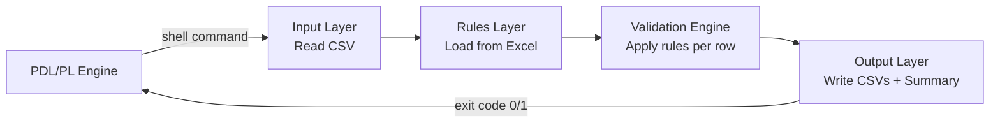
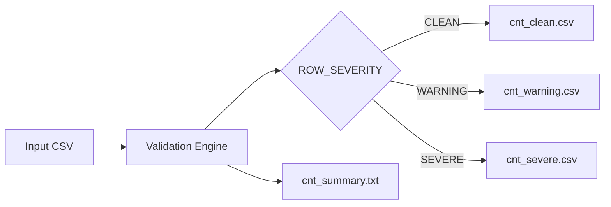
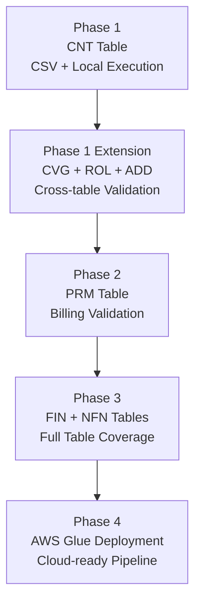

# Policy Loader — ETL Validation POC
## Requirements Document
### Phase 1: Contract (CNT) Table Validation

---

## 1. Background

DXC executes large-scale data conversion projects that move customer data from legacy policy administration systems to modern platforms. These conversions involve hundreds of thousands of active contracts and millions of history records.

The current tooling (KNIME) has proven too slow and too rigid for this scale. This POC replaces it with a lightweight, Python-based ETL validation pipeline that is fast, readable, and easy to extend as new tables and rules are added.

---

## 2. Objective

Build a simple, well-structured ETL validation pipeline that:

- Reads policy data from a CSV file
- Loads validation rules from the field specification Excel file
- Validates each row against those rules
- Classifies each row as CLEAN, WARNING, or SEVERE
- Writes three separate output CSV files and a summary report

The pipeline must be easy to understand, easy to extend, and easy to hand off to any team member.

### Pipeline Flow



---

## 3. Scope — Phase 1

**In scope:**
- Contract (CNT) table only — 32 fields
- CSV file as the data source (no database connection required)
- Validation rules read dynamically from the Excel file in the `rules/` folder
- Local execution (no cloud deployment required for Phase 1)
- Unit tests for all validation logic

**Out of scope for Phase 1:**
- Premium Billing (PRM), Financial History (FIN), Non-Financial History (NFN) tables
- Cross-table validations against PRM, FIN, and NFN (these tables are not yet in scope)
- AWS deployment
- Database connectivity

**Future phases will add:**
- Additional tables (PRM, FIN, NFN)
- Cross-table validations for PRM, FIN, and NFN

**Added in this round (Phase 1 extension):**
- Coverage (CVG) table with cross-table validation against CNT (policy existence check and CVG_REINS_TYPE vs CNT_REINS_TYPE field match)
- Role (ROL) table with cross-table validation against CNT (policy existence check)
- Address (ADD) table with cross-table validation against CNT (policy existence check)

---

## 4. Data Sources

### 4.1 Input Data
- **Format:** CSV file
- **Location:** Local workspace, provided by the team at runtime
- **Content:** One row per contract, with fields matching the CNT field specification

### 4.2 Validation Rules
- **Format:** Excel workbook (`.xlsx`)
- **Location:** `rules/` folder within the local workspace
- **File:** `Validation_Rules_Master.xlsx` (5 tabs: Contract, Address, Roles, Coverage, Cross_References)
- **How used:** `scripts/generate_config_from_master.py` converts the workbook into `templates/v1/validation_rules.csv` and `cross_references.csv`, which the engine reads at runtime — rules are not hardcoded in Python. See `rules/RULES_TEMPLATE_GUIDE.md`.

> Note: This is a Phase-1 requirements document; some sections below predate the
> Option B config-driven engine. The authoritative current design is in
> `.kiro/specs/option-b-config-driven-engine/` and the ADR.

---

## 5. Functional Requirements

### 5.1 Pipeline Behaviour

1. The pipeline reads the input CSV file into memory as a Pandas DataFrame.
2. The rule loader reads the CNT validation rules from the Excel file.
3. The validation engine applies each rule to each row and records the result in a `VAL_<FIELD_NAME>` column.
4. Each row is classified with a `ROW_SEVERITY` value:
   - `CLEAN` — all field validations passed
   - `WARNING` — at least one WARNING, no SEVERE
   - `SEVERE` — at least one SEVERE, regardless of warnings
5. The output writer splits the results into three DataFrames and writes them to separate CSV files.
6. A summary report is printed to the console and written to a text file.

### 5.2 Validation Rules

All validation rules for the CNT table are defined in the Excel file. The pipeline must support the following rule types without code changes:

| Rule Type | Example |
|---|---|
| Not blank | `CNT_COMPANY_CODE` must not be empty |
| Exact length | `CNT_ISSUE_SYSTEM` must be exactly 2 characters |
| Maximum length | `CNT_POLICY_NUMBER` up to 15 characters |
| Allowable values | `CNT_PRODUCT_TYPE` must be one of: A W B T K L I U V E J Z H D |
| Valid date | `CNT_ISSUE_DATE` must be a valid YYYYMMDD date |
| Numeric | `CNT_ISSUE_AGE` must be a numeric value |
| Default then warn | `CNT_BASE_PLAN_CODE` defaults to `CNT_POLICY_PLAN_CODE` if blank, then WARNING |
| Cross-field | `CNT_SEX_CODE = B` requires `CNT_JOINT_LIFE_INDICATOR = F` |
| Date comparison | `CNT_MATURE_EXPIRE_DATE` must be greater than `CNT_ISSUE_DATE` |

### 5.3 Severity Classification

| Specification Language | Severity Assigned |
|---|---|
| "send severe message" | SEVERE |
| "must not be empty / blank" | SEVERE |
| "should not have spaces / blank" | SEVERE |
| "send warning message" | WARNING |
| "default to X if blank" | Apply default silently, then WARNING |

### 5.4 Output Files

| File | Contents |
|---|---|
| `output/cnt_clean.csv` | Rows where all fields passed validation |
| `output/cnt_warning.csv` | Rows with at least one WARNING, no SEVERE |
| `output/cnt_severe.csv` | Rows with at least one SEVERE |
| `output/cnt_summary.txt` | Total rows, counts per severity, top failure reasons |

### Validation Output Split



---

## 6. Non-Functional Requirements

### 6.1 Performance
- The pipeline must process a file of up to 100,000 rows within a reasonable time for a POC (target: under 5 minutes on a standard laptop).
- CSV files must be read in chunks to avoid excessive memory use on large files.

### 6.2 Extensibility
- Adding a new table (e.g., PRM) must not require changes to the core engine modules.
- Adding a new rule type must require changes in only one place.
- The rule loader must be the only module aware of the Excel file format.

### 6.3 Maintainability
- Each module has a single, clearly stated responsibility.
- No module should exceed 200 lines of code where avoidable.
- All functions must include a brief docstring explaining what they do.

### 6.4 Testability
- Every validation function must be independently testable with a small DataFrame.
- Unit tests must cover: all-valid input (CLEAN), single-field SEVERE, single-field WARNING, and cross-field rule triggers.

### 6.5 Usability
- A team member unfamiliar with the project must be able to run the pipeline with a single command.
- Error messages must clearly state which file or field caused the problem.

### 6.6 Portability
- The pipeline must run on any machine with Python 3.12 and the required packages installed.
- No environment-specific paths or hardcoded machine names.

---

## 7. Assumptions and Constraints

- All field names used anywhere in this project — staging schema columns, validation rules, transformation mappings, and generated sample data — must come directly from the `Field Name` column of the table tabs (Contract, Address, Roles, Coverage) in `rules/Validation_Rules_Master.xlsx`. This is the authoritative field definition source. No field name may be invented, abbreviated, renamed, or guessed at, even temporarily or as a placeholder. If a transformation mapping or validation rule needs a field that isn't in a DB_Section sheet, that must be flagged as an open question for BA confirmation — never assumed or fabricated to fill the gap.
- The Excel file is available in the `rules/` folder before the pipeline runs.
- All validation is performed at the application level only — no database constraints are used.
- Primary key for CNT: `CNT_COMPANY_CODE` + `CNT_POLICY_NUMBER`.
- `CNT_REINS_TYPE` cross-table validation now covered by `validate_cvg_cross_table` in Phase 2 scope.

## Default Values and Missing-Data Handling

The same evidence rule that applies to field names and validation rules applies to default values and missing-data handling:

- Kiro is NEVER authorized to invent a default value (e.g. 0, a fixed code, today's date, "N/A") for any field when the source value is missing or blank.
- Before generating sample data, writing a transformation rule, or defining a validation rule that involves a default, Kiro must check whether `Validation_Rules_Master.xlsx` or transformation_mappings.csv explicitly states what should happen when the source is missing.
- If no such rule exists in either source, Kiro must NOT decide silently — whether that means defaulting to a value, leaving it blank, or excluding the field. Instead, Kiro must flag it as an open question requiring BA confirmation, using the same Open Questions Protocol already defined above for field names.
- This applies to all fields, not only newly-added ones — if an existing default is discovered during any future work that has no traceable source, it must also be flagged rather than left as-is or "corrected" based on assumption.

## Data Source Authority (Excel-Based)

### Validation Source of Truth

- The single workbook `rules/Validation_Rules_Master.xlsx` is the sole authoritative source for all validation rule definitions. No hardcoded Python dict and no manually-authored validation_rules.csv/cross_references.csv serves as a runtime source of truth — the CSVs are always regenerated from the workbook.
- The input adapter reads the workbook's explicit columns (`Field Name`, `Rule Type`, `Severity`, `Allowable Codes`, `Length`, `Precision`, plus the Cross_References columns) by header text. Rule type and severity are read verbatim — never inferred from prose.
- The adapter reads the four table tabs for field-level rules and the `Cross_References` tab for cross-reference rules; one row per (field, rule).
- The Option B engine interprets the generated `validation_rules.csv` and `cross_references.csv` at runtime with no hardcoded field names or rule logic. (The former Option A modules `rule_loader.py`/`validate_*.py` are retired under `_deprecated_src_do_not_use/`.)

### Sample Data Source

- The 4 Sample_*_Data.xlsx files in staging_data/ replace the synthetic generator entirely. No scripts/generate_sample_data.py shall exist in this project.
- When reading Sample_*_Data.xlsx files, the reader must use dtype=str (or equivalent text-mode reading) to prevent numeric reinterpretation of fields — specifically: CVG_SEQUENCE_NUMBER and CVG_PERSON_SEQ are stored as integers in the source and must not lose leading zeros if real data ever contains them.

### Mapping Source of Truth (EA_Transaction_Mapping.xlsx)

- rules/EA_Transaction_Mapping.xlsx, sheet "Trx Mapping", is the sole authoritative source for transformation_mappings.csv generation. Sheet1 (scratch notes) is excluded from generation entirely.
- Column mapping for generation: target_field parsed from Col A (stripping COBOL level number); source_field from Col I ("Policy Data Loader Mapping"); source_table inferred from Col I prefix (CNT_/CVG_/ROL_/ADD_); target_length and target_data_type parsed from PIC clause in Col C; sequence from row order.
- Transformation type is determined by bounded inference rules only (GROUP_OR_PARENT, SYSTEM_GENERATED, INITIALIZE_SPACES, DIRECT_SOURCE/DATE_SPLIT, CONDITIONAL_OR_DERIVED) — anything not matching must be flagged as "needs manual review", never guessed at.
- Any row where required parsing fails must be output to a separate "needs review" list — not included in transformation_mappings.csv with a guessed value, and not silently dropped.

### Dual Output Format

- The transformation engine produces both a positional flat file (ea_transaction.txt) and a CSV equivalent from a single transformation pass — no duplicate processing.
- The CSV includes readable column headers using actual target field names (e.g., "COMPANY-CODE"), not positional offsets.
- The CSV is the BA-facing review deliverable; the flat file remains the system-of-record format for downstream consumers.

---

## 8. Integration with the PDL/PL Engine

### 8.1 Invocation

The pipeline replaces the existing KNIME workflow in the DXC conversion toolchain. It is triggered by the PDL/PL engine via a shell command (e.g., `python -m cnt_etl_validation ...`). No manual user interaction is required at runtime.

### 8.2 Runtime Parameters

The PDL/PL engine passes the following as command-line arguments:

| Parameter | Description |
|---|---|
| `--input-file` | Full path to the input CSV file to be validated |
| `--output-dir` | Full path to the directory where output files will be written |

No paths are hardcoded; the pipeline uses only what is supplied at invocation.

### 8.3 Exit Codes

| Exit Code | Meaning | PDL/PL Engine Action |
|---|---|---|
| `0` | Pipeline completed successfully (all outputs written) | Continue downstream processing |
| `1` | Pipeline failed (missing file, unhandled exception, etc.) | Halt and report error |

The engine relies on these exit codes to decide whether to proceed with downstream steps.

### 8.4 Advantages over KNIME

| Advantage | Detail |
|---|---|
| Speed | Native Python / Pandas processes large files significantly faster than KNIME nodes |
| Git versioning | All pipeline code lives in a standard Git repository — full change history and branching |
| Extensibility | New tables and rule types are added via code, not drag-and-drop node editing |
| Portability | Runs anywhere Python 3.12 is installed — no platform-specific IDE needed |
| No licence cost | Relies only on open-source packages; no commercial KNIME extensions required |

---

## 9. Phased Delivery Plan

| Phase | Scope | Goal |
|---|---|---|
| Phase 1 (complete) | CNT table, CSV source, local execution | Working demo with one table |
| Phase 1 Extension (complete) | CVG, ROL, ADD tables, cross-table validation against CNT | Cross-reference validation proven |
| Phase 2 | PRM table, cross-table validation against CNT and other tables | Billing table validation |
| Phase 3 | FIN and NFN tables | Full table coverage |
| Phase 4 | AWS Glue deployment | Cloud-ready production pipeline (see Future Execution Engine section) |

### Phase Progression



---

*Requirements version: Phase 1*
*Source specification: `rules/Validation_Rules_Master.xlsx`*
*Last updated: July 2026*

---

## Future Execution Engine - AWS Glue

### Current State

The POC runs as a local Python script:

```
python src/main.py --input-file <file> --output-dir <dir>
```

This is intentional. The POC proves the validation logic is correct. Execution infrastructure is addressed in the production phase.

### Intended Production Engine

AWS Glue Python Shell is the recommended execution engine for production. It runs the existing Pandas validation code with no logic changes required. Only the entry point changes from `main.py` to a Glue job script.

### Parallelism Model

Two levels of parallelism will be applied:

**Level 1 - Table-level (concurrent.futures)**

CNT must complete first as it is the parent table. All other tables (PRM, FIN, NFN, CVG, ROL, ADD) run simultaneously once CNT is complete. This means total elapsed time equals the slowest single table, not the sum of all seven.

**Level 2 - Chunk-level (Pandas chunksize)**

Large input files are read in chunks of 50,000 rows to avoid memory pressure on the Glue node. Chunks are concatenated into a single dataframe before validation begins.

### AWS Glue Job Configuration (for future reference)

| Parameter | Value |
|---|---|
| Job type | Python Shell |
| Python version | 3.9 |
| Max capacity | 1 DPU |
| Timeout | 60 minutes |
| Max retries | 1 |

Job parameters:

| Parameter | Description |
|---|---|
| `--INPUT_BUCKET` | S3 bucket containing input files |
| `--INPUT_PREFIX` | S3 folder path for input |
| `--OUTPUT_BUCKET` | S3 bucket for output files |
| `--OUTPUT_PREFIX` | S3 folder path for output |

### Trigger

The PDL/PL engine triggers the Glue job with a single `start_job_run()` API call, passing the input and output bucket parameters. No orchestration service (such as Step Functions) is required. All parallelism is handled inside the Glue job itself.
